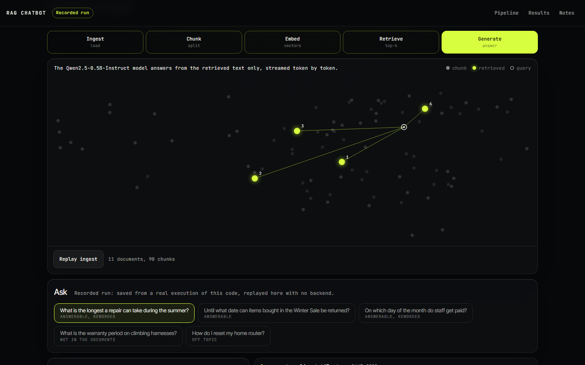
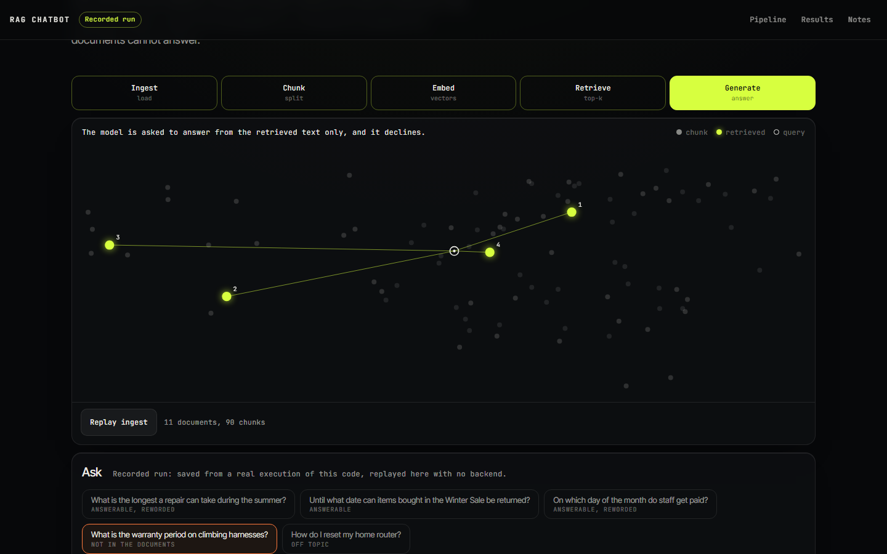
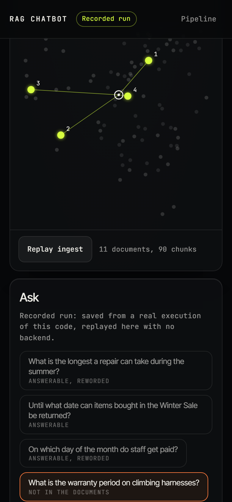
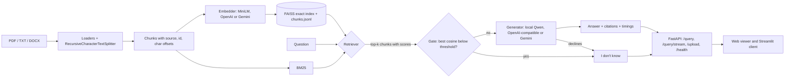

# LLM-Powered RAG Chatbot

Question answering over your own documents, with the answer tied to the text it came from. It ingests PDF, TXT and DOCX files, splits them into chunks, embeds them into a FAISS index, retrieves the best chunks for a question (dense, BM25 or a fusion of both), and has a language model answer from those chunks only, saying "I don't know" when they do not contain the answer. Python, LangChain, FAISS, FastAPI, Streamlit and Docker. It runs with no API key: the default embedder and generator are small open models that run on a laptop.

I rebuilt this from a small Gemini-only wrapper into something I can measure. The part I care about is the "I don't know" path, so the repository ships a small corpus and a question set (answerable and unanswerable) and reports how often the system answers correctly, how often it declines when it should, and how often it declines when it should not.



The interface in `docs/` walks the pipeline step by step (ingest, chunk, embed, retrieve, generate) with real data: the bars are the documents, the points are their chunks projected from the embedding space, and the lime points are what the retriever returned for the question, with their scores. The static page replays queries recorded from a real run (it says so in the page); run the service locally and the same page talks to your own documents.

| Desktop: a question the documents cannot answer | Phone (390 px) |
|---|---|
|  |  |

## Read this before trusting any number

- **The corpus is small and invented.** 11 documents about a fictional outdoor-gear retailer, written by me so that they are licence-clean and so that no model has seen them. The questions are also mine. Retrieval scores are high partly because the corpus is easy: the documents are short and cleanly sectioned. This measures whether the pipeline works and which options help, not how it will do on your messy PDFs.
- **Small samples.** 75 answerable and 25 unanswerable questions. Rates carry 95% Wilson intervals in the tables, and a difference of one or two questions is noise.
- **Answer correctness is a word match.** An answer counts as correct if it contains every required fact (a number, a name) after normalising currency and punctuation. It is strict about wording and blind to meaning, so it can fail a right answer phrased differently and pass a wrong answer that happens to include the right words. "Grounded" is likewise lexical: the share of the answer's words that appear in the retrieved text. Neither is a human judgement.
- **The generator is tiny.** The default model has 0.5 billion parameters. It follows "answer only from the context, otherwise say I don't know" only partly, and the tables show where it does not.
- **Hosted providers were not run.** The OpenAI-compatible and Gemini adapters are tested against a stubbed HTTP transport. I have no keys, so they have never called a real service. The Docker image was not built here either (no Docker on the machine I developed on).

## Results

Reproduce with the commands under "Reproduce", then `python scripts/check_numbers.py --write`. Every table in this section is generated from `results/*.json`, and a fast test fails if the README is out of sync.

<!-- BEGIN setup -->
<!-- END setup -->

### Headline

<!-- BEGIN headline -->
<!-- END headline -->

### Retrieval: chunk size and retriever

Recall@k: some chunk in the top k covers the gold passage (at least half of it, or 60 characters). MRR: mean reciprocal rank of the first such chunk, over the top 10. "Answer facts in top-3 text": the top-3 chunks together contain every fact the answer needs, which does not depend on where chunk boundaries fall, so it is comparable across chunk sizes. The reranker rows add the cross-encoder `cross-encoder/ms-marco-MiniLM-L-6-v2` (Apache-2.0) over the hybrid candidates.

<!-- BEGIN retrieval -->
<!-- END retrieval -->

Split by how the question is worded (the default chunk size):

<!-- BEGIN retrieval_kind -->
<!-- END retrieval_kind -->

### Answers

<!-- BEGIN gen_qwen2.5-0.5b-instruct_c500 -->
<!-- END gen_qwen2.5-0.5b-instruct_c500 -->

<!-- BEGIN gen_qwen2.5-1.5b-instruct_c500 -->
<!-- END gen_qwen2.5-1.5b-instruct_c500 -->

With 1,000-character chunks:

<!-- BEGIN gen_qwen2.5-0.5b-instruct_c1000 -->
<!-- END gen_qwen2.5-0.5b-instruct_c1000 -->

<!-- BEGIN gen_extractive -->
<!-- END gen_extractive -->

### The retrieval-score gate

<!-- BEGIN gate -->
<!-- END gate -->

### Latency

CPU timing, end to end for one question (embed the question, search, generate), on the machine described in the table:

<!-- BEGIN latency -->
<!-- END latency -->

GPU generation time per question during the runs above (not a CPU claim):

<!-- BEGIN gpu_latency -->
<!-- END gpu_latency -->

## Architecture



Everything is in `src/rag_chatbot/`: `loaders.py` (loading, chunking, upload checks), `embeddings.py` and `llm.py` (provider adapters), `store.py` (FAISS and persistence), `retrieval.py` (dense, BM25, fusion, optional reranker), `pipeline.py` (prompt, gate, cache, history, query log, citations), `api.py` (service), `evaluation.py` (metrics), `cli.py`.

## Quickstart

Offline, no key. The first run downloads two small models (about 90 MB for MiniLM, about 1 GB for Qwen2.5-0.5B-Instruct) from the Hugging Face hub; after that it is offline.

```bash
git clone https://github.com/Aditya2616/LLM-Powered-RAG-Chatbot.git
cd LLM-Powered-RAG-Chatbot
python -m venv .venv && source .venv/bin/activate     # Windows: .venv\Scripts\activate
pip install -e ".[local]"
rag-chatbot ingest corpus/docs
rag-chatbot ask "How long does a PayPal refund take?"
rag-chatbot ask "What is the capital of France?"        # not in the documents: expect "I don't know"
rag-chatbot serve                                         # http://127.0.0.1:8000 : the viewer and the API
```

With no model download at all (a lexical embedder and an extractive generator that returns the best-matching sentence), useful for checking the plumbing:

```bash
pip install -e .
EMBEDDINGS_PROVIDER=hashing LLM_PROVIDER=extractive rag-chatbot ingest corpus/docs
EMBEDDINGS_PROVIDER=hashing LLM_PROVIDER=extractive rag-chatbot ask "When are PayPal refunds issued?"
```

On Windows PowerShell set the variables with `$env:EMBEDDINGS_PROVIDER = "hashing"`. Copy `.env.example` to `.env` to keep settings; every variable is optional.

### Models and providers

| | Default | Alternatives |
|---|---|---|
| Embeddings (`EMBEDDINGS_PROVIDER`) | `huggingface`: `sentence-transformers/all-MiniLM-L6-v2` (Apache-2.0), local | `openai` (any OpenAI-compatible `/embeddings`), `gemini`, `hashing` (no model) |
| Generator (`LLM_PROVIDER`) | `local`: `Qwen/Qwen2.5-0.5B-Instruct` (Apache-2.0), float16 on CUDA, float32 on CPU | `openai` (any OpenAI-compatible `/chat/completions`, set `OPENAI_BASE_URL`), `gemini`, `extractive` (no model) |

Hosted model ids are never defaulted: set `OPENAI_MODEL`, `OPENAI_EMBEDDING_MODEL`, `GEMINI_MODEL` and `GEMINI_EMBEDDING_MODEL` yourself. Pointing `OPENAI_BASE_URL` at another provider's compatible endpoint is how to use one that is not named here; that path is untested beyond the stubs. Use another local model with `LOCAL_LLM_MODEL` or `HF_EMBEDDING_MODEL`. An index records which embedder built it and is refused if you change embedders; run `rag-chatbot reindex`.

## API

`rag-chatbot serve` starts the service (interactive docs at `/docs`).

```bash
# upload documents (.pdf, .txt, .docx; validated by content, 10 MB and 10 files by default)
curl -X POST http://localhost:8000/upload -F "files=@corpus/docs/returns_and_refunds.txt"

# or load the bundled corpus
curl -X POST http://localhost:8000/documents/sample

# ask
curl -X POST http://localhost:8000/query -H "Content-Type: application/json" \
  -d '{"question": "How long does a PayPal refund take?", "top_k": 4}'

# stream: server-sent events "retrieval" (chunks and scores), "token" (text), "done" (the /query payload)
curl -N -X POST http://localhost:8000/query/stream -H "Content-Type: application/json" \
  -d '{"question": "What is the staff discount after probation?"}'

curl http://localhost:8000/health
curl http://localhost:8000/documents
```

A `/query` response carries the answer, whether it abstained and why (`model_declined`, `low_retrieval_score` or `empty_index`), the sources, and timings. The shape (the values here are illustrative, not a recorded response):

```json
{
  "answer": "PayPal refunds are issued within 2 working days of inspection.",
  "abstained": false,
  "abstain_reason": null,
  "sources": [{"rank": 1, "source": "returns_and_refunds.txt", "chunk": 4, "chunk_id": "returns_and_refunds.txt#4",
               "start": 1180, "end": 1646, "score": 0.0328, "dense": 0.6012, "bm25": 7.41, "support": 0.82,
               "snippet": "...", "text": "..."}],
  "cached": false,
  "retriever": "hybrid",
  "model": {"embeddings": "huggingface:sentence-transformers/all-MiniLM-L6-v2", "llm": "local:Qwen/Qwen2.5-0.5B-Instruct"},
  "timings": {"retrieve_ms": 12.3, "generate_ms": 640.1, "total_ms": 653.0}
}
```

A source is a chunk that was put in the prompt; `support` is the share of the answer's content words found in that chunk. The service also keeps an in-memory LRU cache with a time-to-live, short per-session chat history, and a JSON-lines query log (`data/query_log.jsonl`). The index persists in `data/vector_store/`.

Streamlit client (the original UI, updated to show scores and the reason for a refusal): start the service, then `pip install -e ".[streamlit]"` and `streamlit run frontend/streamlit_app.py`.

Docker: `docker build -t rag-chatbot .` then `docker run -p 8000:8000 -v rag-data:/data -v rag-models:/models rag-chatbot`. The image installs CPU PyTorch and downloads the models on first use. I did not build it here.

## The static demo

`docs/` is a static site: serve it with any file server (`python -m http.server -d docs`) or GitHub Pages. It replays `docs/data/demo.json`, which `scripts/record_demo.py` wrote from a real run (chunk layout, 2-D projection, retrieved chunks and scores, the token stream with its real timing, the final answers), including a question on a topic the documents cover but a detail they do not, and an off-topic one. When the same page is served by the service it switches to live mode and sends your questions to it.

## Design decisions and limitations

Short version; the longer notes are in `docs/notes/DESIGN.md`.

- Exact FAISS search over normalised vectors (cosine). Fine for thousands of chunks; for millions you would want an approximate index, which I have not built or measured.
- BM25 is my own small implementation with a plural-stripping stemmer, so it is English only.
- Chunking is by characters, with 15% overlap in the experiments. Tables, scanned PDFs (no OCR) and layout are not handled.
- Chat history is pasted into the prompt as text; there is no question rewriting, so follow-up questions that depend on earlier turns retrieve poorly.
- The cache and the history are in memory and per process; the service is meant to run as a single worker.
- There is no authentication, rate limiting or per-user isolation. It is a local tool, not a hosted product.
- The abstention gate depends on one threshold tuned on a small question set; the results above show how far to trust it.

## Layout

```
src/rag_chatbot/   the package (see Architecture)
corpus/docs/       the 11 bundled documents; corpus/questions.jsonl the gold questions
scripts/           run_eval.py, record_demo.py, check_numbers.py, check_ui.py
results/           measured results (JSON), the source of every table above
docs/              the static viewer, data/ (recorded run), assets/ (screenshots), notes/
frontend/          the Streamlit client
tests/             fast offline suite; the model test is marked slow
```

## Reproduce

```bash
pip install -e ".[local,dev]"
python scripts/run_eval.py retrieval
python scripts/run_eval.py generation --model Qwen/Qwen2.5-0.5B-Instruct --chunk-size 500
python scripts/run_eval.py generation --model Qwen/Qwen2.5-0.5B-Instruct --chunk-size 1000
python scripts/run_eval.py generation --model Qwen/Qwen2.5-1.5B-Instruct --chunk-size 500
python scripts/run_eval.py extractive
python scripts/run_eval.py latency --model Qwen/Qwen2.5-0.5B-Instruct --threads 4
python scripts/record_demo.py --queries <ids from corpus/questions.jsonl>
python scripts/check_numbers.py --write
pytest                      # fast, offline, no model downloads
pytest -m slow              # loads the real models
ruff check .
```

The fast suite uses a hashing embedder and scripted generators, so it needs neither torch nor a download; that is what CI runs. The interface check (`python scripts/check_ui.py --live --shots docs/assets`, needs `pip install -e ".[check]"` and `playwright install chromium`) loads the page at 1440x900 and 390x844 and fails on console errors, horizontal scroll or touch targets under 44 px.

## Credits and licence

MIT, copyright Aditya Jain (see `LICENSE`). Models: `sentence-transformers/all-MiniLM-L6-v2`, `Qwen/Qwen2.5-0.5B-Instruct`, `Qwen/Qwen2.5-1.5B-Instruct` and `cross-encoder/ms-marco-MiniLM-L-6-v2`, all Apache-2.0 per their model cards; they are downloaded, not bundled. The corpus and questions are my own work, covered by the same MIT licence.

Built by [Aditya Jain](https://adityajain16.vercel.app).
